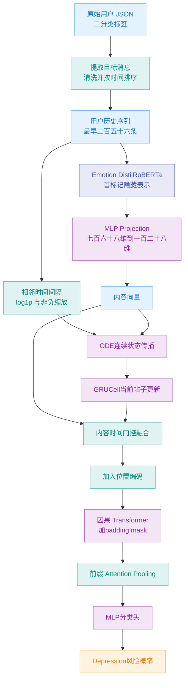

# Emotion-ODE-Transformer 实验结构

## 1. 模型边界

本实验只包含以下信息流：

```text
目标用户历史消息
→ 情绪模型帖子表示
→ MLP投影
→ 连续时间ODE状态
→ GRU消息更新
→ 内容时间融合
→ Transformer序列建模
→ 用户级分类
```

不引入讨论上下文分支、BDI症状分支、同伴基线 embedding 或其他数据集。

## 2. 总体结构



## 3. 数据契约

每条有效事件至少包含：

| 字段 | 含义 |
|---|---|
| `user_id` | 文件所属目标用户ID |
| `event_id` | submission或comment唯一ID |
| `kind` | submission或comment |
| `created_utc` | UTC时间戳 |
| `text` | 清洗后的模型输入文本 |
| `label` | Depression为1，Control为0 |
| `position` | 用户内从0开始的位置 |
| `delta_days` | 与前一条有效消息的间隔 |

目标消息以 `target=true` 判断。submission文本为 `title [SEP] body`，comment文本为 `body`。

## 4. 张量定义

设批量大小为 (B)，序列长度为 (N=256)，模型维度为 (d=128)：

| 张量 | 形状 | 描述 |
|---|---:|---|
| `post_hidden` | `B × N × 768` | 情绪模型首标记表示 |
| `post_embedding` | `B × N × 128` | MLP投影结果 |
| `delta_scale` | `B × N` | 非负连续时间尺度 |
| `position` | `B × N` | 帖子位置 |
| `padding_mask` | `B × N` | 有效消息标记 |
| `ode_state` | `B × N × 128` | 连续时间用户状态 |
| `sequence_hidden` | `B × N × 128` | Transformer输出 |
| `prefix_logits` | `B × N` | 每个可见前缀的风险logit |

## 5. 帖子投影

情绪模型输出：

\[
h_i=\operatorname{EmotionEncoder}(P_i)_{0}\in\mathbb{R}^{768}
\]

投影层：

\[
e_i=\operatorname{LayerNorm}
\left[
W_2\operatorname{Dropout}
\left(
\operatorname{GELU}(W_1h_i+b_1)
\right)+b_2
\right]
\]

维度为 `768 → 256 → 128`。

## 6. 连续时间编码

时间间隔以天为单位：

\[
\Delta t_1=0,
\qquad
\Delta t_i=\max\left(0,\frac{t_i-t_{i-1}}{86400}\right)
\]

训练折内计算：

\[
d_i=\min\left(
\frac{\log(1+\Delta t_i)}{q_{99}^{train}+\epsilon},1
\right)
\]

因此 (d_i\in[0,1])，不会因为中心化而产生负积分时长。

批量ODE使用统一积分区间：

\[
\frac{dz}{d\tau}=d_i f_\theta(\tau,z),
\qquad \tau\in[0,1]
\]

\[
\tilde z_i=\operatorname{ODESolve}
\left(d_if_\theta,z_{i-1},[0,1]\right)
\]

向量场使用 `LayerNorm → Linear → Tanh → Linear`，不在ODE函数中使用Dropout。

当前消息更新：

\[
z_i=\operatorname{GRUCell}(e_i,\tilde z_i)
\]

首状态为可学习参数 (z_0)。padding位置保持上一状态不变。

## 7. 内容时间融合

\[
g_i=\sigma\left(W_g[e_i;z_i]+b_g\right)
\]

\[
x_i=\operatorname{LayerNorm}
\left(
g_i\odot W_ee_i+
(1-g_i)\odot W_zz_i
\right)
\]

再加入位置编码：

\[
x'_i=x_i+p_i
\]

ODE描述真实时间距离，位置编码描述消息次序。

## 8. Transformer与池化

Transformer使用两层、四个attention heads、512维前馈层、GELU和0.2 dropout。训练和推理均使用causal mask与padding mask。

第 (k) 个前缀的attention pooling：

\[
a_i=v^\top\tanh(W_hH_i+b_h)
\]

\[
\alpha_i^k=\frac{\exp(a_i)}{\sum_{j=1}^{k}\exp(a_j)}
\]

\[
u_k=\sum_{i=1}^{k}\alpha_i^kH_i
\]

分类头为 `Linear 128 → 64 → GELU → Dropout → Linear 1`。

## 9. 损失函数

最终损失同时约束完整可见序列和早期前缀：

\[
\mathcal L=\mathcal L_{final}+0.5\mathcal L_{prefix}
\]

前缀集合为：

\[
K=\{1,2,4,8,16,32,64,128,256\}
\]

先对同一用户的有效前缀损失求平均，再在用户之间求平均，避免长序列用户获得更高权重。正类权重只由当前训练折计算。

## 10. 主配置

| 模块 | 配置 |
|---|---|
| 文本编码器 | Emotion English DistilRoBERTa Base |
| 文本池化 | 最后一层首标记 |
| 最大token数 | 256 |
| 最大帖子数 | 256 |
| 模型维度 | 128 |
| ODE求解器 | RK4 |
| ODE步长 | 0.25 |
| Transformer层数 | 2 |
| Attention heads | 4 |
| Feed-forward维度 | 512 |
| Batch size | 128 users（RTX 4060 8 GB） |
| 优化器 | AdamW |
| 学习率 | 8e-4 |
| Weight decay | 1e-2 |
| Gradient clip | 1.0 |
| Early stopping | Validation PR-AUC |
| 随机种子 | 42、43、44 |

## 11. 阈值与评估协议

每个 fold/seed 先在对应验证集上，以 0.005 为步长扫描 `[0,1]` 阈值，并最大化 F-latency。早期告警定义为连续两个有效前缀概率达到阈值，告警位置是完成这段连续越阈的帖子序号。主结果在每个 fold 内先对三个 seed 的最终概率和逐前缀概率取算术平均，再在验证集集成预测上锁定一次阈值，最后原样应用于该 fold 的外层测试用户。

完整序列分类与早期告警分开报告：前者用最后一个有效前缀概率产生 `final_prediction`，后者用连续越阈规则产生 `alert_prediction` 和 `alert_position`。PR-AUC、ROC-AUC 和 Brier Score 使用完整序列概率；Precision、Recall、F1、Macro-F1、Balanced Accuracy 与 MCC 使用完整序列二元预测；ERDE 和 F-latency 使用早期告警。

ERDE 采用 [eRisk 2017 官方定义](https://tec.citius.usc.es/ir/pdf/eRisk2017.pdf)：误报代价为当前评估用户集合的正类比例，漏报代价为 1，真阳性代价为随已观察帖子数增长的延迟函数。F-latency 采用 [eRisk 2021 官方定义](https://www.ceur-ws.org/Vol-2936/paper-72.pdf)：

\[
penalty(k)=-1+\frac{2}{1+\exp[-0.0078(k-1)]}
\]

\[
speed=1-\operatorname{median}\{penalty(k_u):u\text{ 为真阳性告警}\}
\]

\[
F_{latency}=F_1\times speed
\]

五个外层测试折合并成唯一 OOF 用户集；三个 seed 不作为重复用户进入 OOF。95% 置信区间使用 2,000 次用户级 percentile bootstrap。阈值重放、用户覆盖、概率范围、文件校验和和指标重算由 `scripts/validate_evaluation.py` 验证。

## 12. 可视化规范

正式结果至少包含：

1. 数据类别分布和用户序列长度分布。
2. 原始时间间隔与 `log1p` 时间间隔分布。
3. 训练损失与验证PR-AUC曲线。
4. 测试集ROC与Precision–Recall曲线。
5. 混淆矩阵。
6. 不同前缀长度下的PR-AUC、F1和Recall。
7. 正确阳性用户的检测延迟分布。
8. 代表性用户的风险概率时间轨迹。
9. 代表性用户的attention权重和时间间隔联合图。

图表必须标明fold聚合方式、误差范围、样本数、坐标单位和分类阈值来源。
